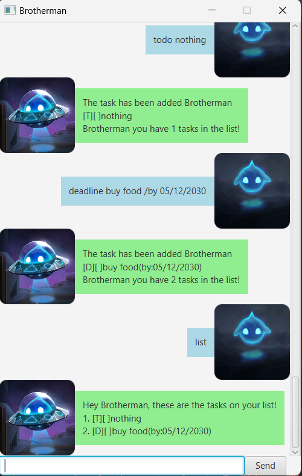
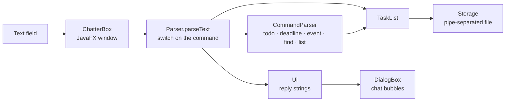

<div align="center">

# ChatterBox

**A keyboard-first task manager with a chat-style JavaFX window.**<br>
To-dos, deadlines and events, typed as commands and saved to disk, with search, marking and a
guarded delete-all. My CS2103 individual project: one Java codebase grown increment by increment,
from a console echo bot to a released, tested GUI app.

[](https://github.com/sp4ce-cowboy/ip/blob/7fc98c35782676316efcce0303ce35eaec15c2d3/src/main/java/duke/Parser.java#L130-L243)
[](https://github.com/sp4ce-cowboy/ip/blob/7fc98c35782676316efcce0303ce35eaec15c2d3/src/main/java/duke/ChatterBox.java)
[](build.gradle)
[](src/test/java/duke)


</div>

> [!NOTE]
> This consolidated README page was added by
> [Claude Opus 5.5](https://docs.anthropic.com/en/docs/claude-code) in Nov 2026 using my
> [agentic-repo-analysis](https://github.com/sp4ce-cowboy/agentic-workflows) skill, from the
> project's code, git history and user guide. The project itself is from Aug – Oct 2023. The
> original README is in **[README-ORIGINAL.md](README-ORIGINAL.md)**; the user guide is
> **[on GitHub Pages](https://sp4ce-cowboy.github.io/ip/)**.

## At a glance

| | |
|---|---|
| **What** | A desktop task manager: CLI-style input, chat-style GUI output, tasks kept in a local file |
| **Context** | NUS [CS2103](https://nusmods.com/courses/CS2103/software-engineering) *Software Engineering*, AY2023/24 Semester 1, the individual project (iP), forked from the course's [Duke template](https://github.com/nus-cs2103-AY2324S1/ip). Before the team project, [UniCa$h](https://github.com/sp4ce-cowboy/tp) |
| **Stack** | Java 11, JavaFX, Gradle (Shadow jar, Checkstyle), JUnit 5, a shell text-UI regression test |



## Features

| Command | Does |
|---|---|
| `todo <task>` · `deadline <task> /by YYYY-MM-DD` · `event <task> /from <start> /to <end>` | Add a task; deadlines are parsed into dates |
| `list` · `find <keyword>` | Show all tasks, or those matching a keyword |
| `mark <n>` · `unmark <n>` · `delete <n>` | Change or remove a task |
| `delete_all` | Start over. Left out of the help screen on purpose, so nobody wipes their list by accident |
| `help` · `bye` | The start screen again; exit |

## How it works



- **Parsing:** [`Parser.parseText`](https://github.com/sp4ce-cowboy/ip/blob/7fc98c35782676316efcce0303ce35eaec15c2d3/src/main/java/duke/Parser.java#L130-L243)
  switches on the command word and delegates task creation to
  [`CommandParser`](https://github.com/sp4ce-cowboy/ip/blob/7fc98c35782676316efcce0303ce35eaec15c2d3/src/main/java/duke/CommandParser.java),
  with assertions on its inputs and a `DukeException` for user errors.
- **Model:** `ToDo`, `Deadline` (with a `LocalDate`) and `Event` extend an abstract `Task`;
  `TaskList` holds them.
- **Storage:** every change is written straight to a pipe-separated file, read back at start-up
  ([`Storage`](https://github.com/sp4ce-cowboy/ip/blob/7fc98c35782676316efcce0303ce35eaec15c2d3/src/main/java/duke/Storage.java#L50-L112)).
- **GUI:** `ChatterBox` builds the JavaFX window; `DialogBox` renders each exchange as a bubble
  with an avatar.

## Skills shown

| Skill | Where it shows (click the links for the code) | Docs |
|---|---|---|
| **Java and OOP**<br> | Abstract `Task` with three subclasses, a parser, custom exceptions, assertions: [`Parser`](https://github.com/sp4ce-cowboy/ip/blob/7fc98c35782676316efcce0303ce35eaec15c2d3/src/main/java/duke/Parser.java#L130-L243) | [Java 11 API](https://docs.oracle.com/en/java/javase/11/docs/api/) |
| **Desktop GUI**<br> | Chat-style window and dialog bubbles: [`ChatterBox`](https://github.com/sp4ce-cowboy/ip/blob/7fc98c35782676316efcce0303ce35eaec15c2d3/src/main/java/duke/ChatterBox.java), [`DialogBox`](https://github.com/sp4ce-cowboy/ip/blob/7fc98c35782676316efcce0303ce35eaec15c2d3/src/main/java/duke/DialogBox.java) | [JavaFX](https://openjfx.io/) |
| **File persistence** | Save on every change, load at start: [`Storage`](https://github.com/sp4ce-cowboy/ip/blob/7fc98c35782676316efcce0303ce35eaec15c2d3/src/main/java/duke/Storage.java#L50-L112) | |
| **Testing** | JUnit 5 tests for the parser, storage, UI and app ([`src/test`](src/test/java/duke)), and a text-UI regression script ([`text-ui-test`](text-ui-test)) | [JUnit 5](https://junit.org/junit5/docs/current/user-guide/) |
| **Build and release** | Gradle with a Shadow fat jar and Checkstyle; tagged releases | [Gradle](https://docs.gradle.org/) |
| **Incremental delivery with Git** | 38 tagged increments (Level-0 to Level-10, A-JUnit, A-Jar, A-Assertions…), feature branches merged by pull request | |

## Coding stats

From git.

| | |
|---|---|
| **Period** | 24 Aug – 7 Oct 2023 |
| **Active days** | 14 |
| **Commits** | **80** of mine: 9 in Aug, 61 in Sep, 8 in Oct (and 2 README edits in Jan 2024) |
| **Lines** | about 3,400 added and 1,200 removed; 1,482 lines of Java in `main`, 153 in tests |
| **Increments** | 38 tags, 2 merged pull requests |

```text
Commits per month
Aug 2023  ███                       9
Sep 2023  ████████████████████     61
Oct 2023  ███                       8
```

## On my resume

**Skills:** Java 11 · JavaFX · Gradle · JUnit 5 · OOP · file persistence · Git workflow

- Built ChatterBox, a desktop task manager in Java 11 and JavaFX (1.5k lines), with CLI-style input, chat-style output, and to-dos, dates-aware deadlines and events saved to a local file on every change.
- Designed the command layer as a parser that dispatches to per-command handlers over an abstract `Task` hierarchy, with assertions and a custom exception type for clear user errors.
- Delivered it in 38 tagged increments over six weeks (80 commits), from a console echo bot to a GUI release, using feature branches and pull requests.
- Tested it with JUnit 5 (parser, storage, UI) and a text-UI regression script, and packaged it as a Shadow fat jar with Checkstyle enforced in Gradle.

## Getting started

Download the jar from the [latest release](https://github.com/sp4ce-cowboy/ip/releases/tag/A-Release-3.2)
(`duke.jar`) and run `java -jar duke.jar` (Java 11), or build from source with `./gradlew run`.
